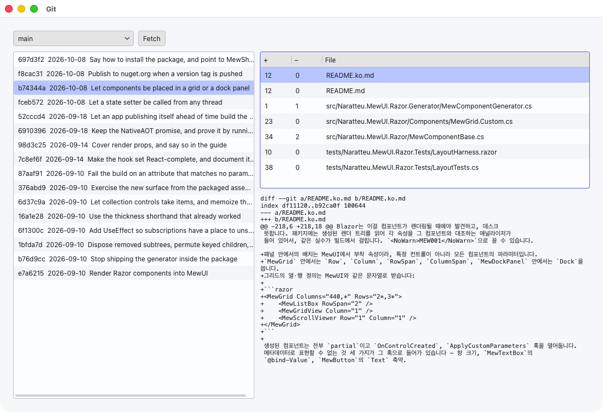
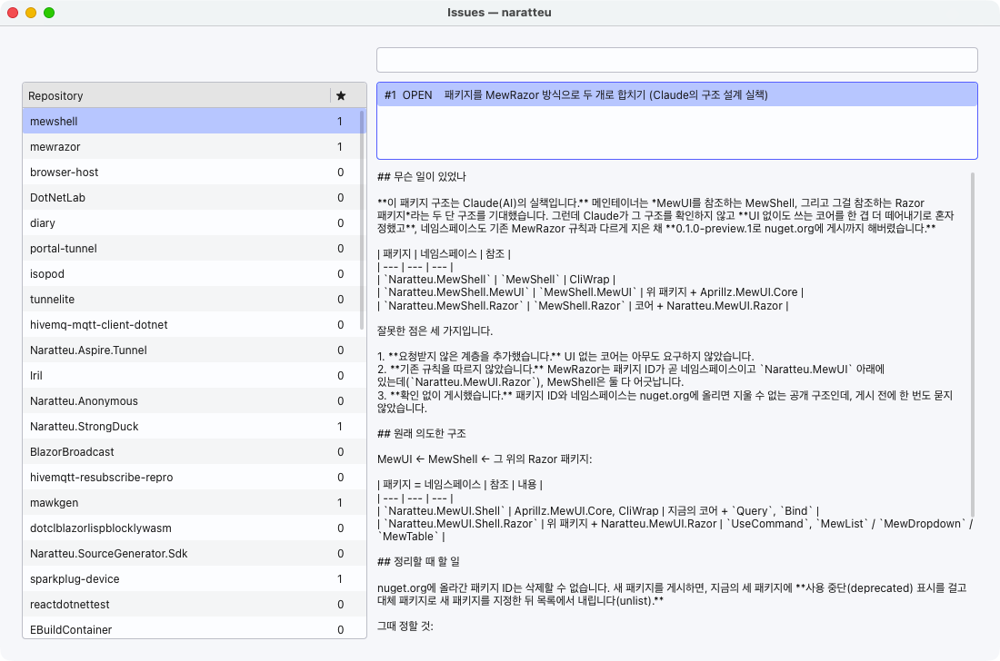
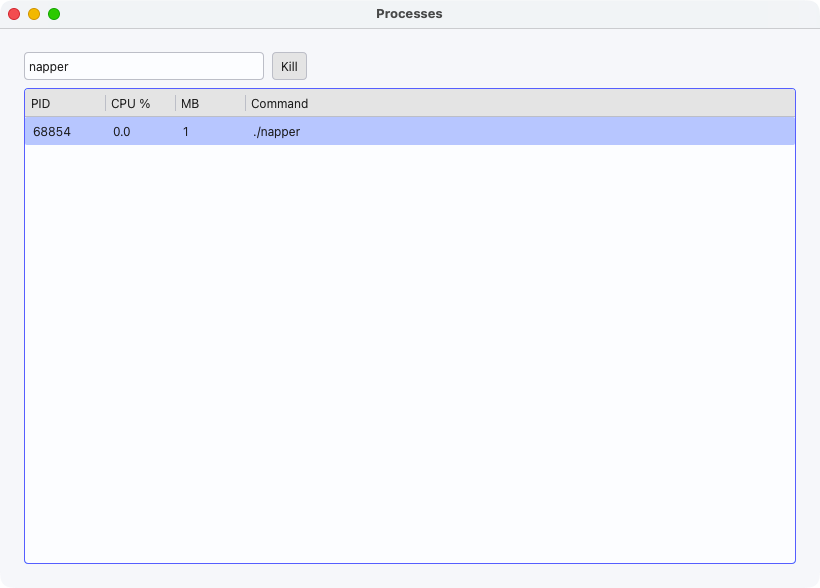
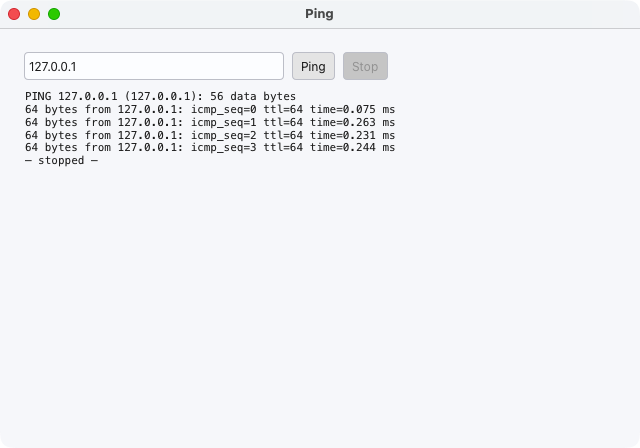
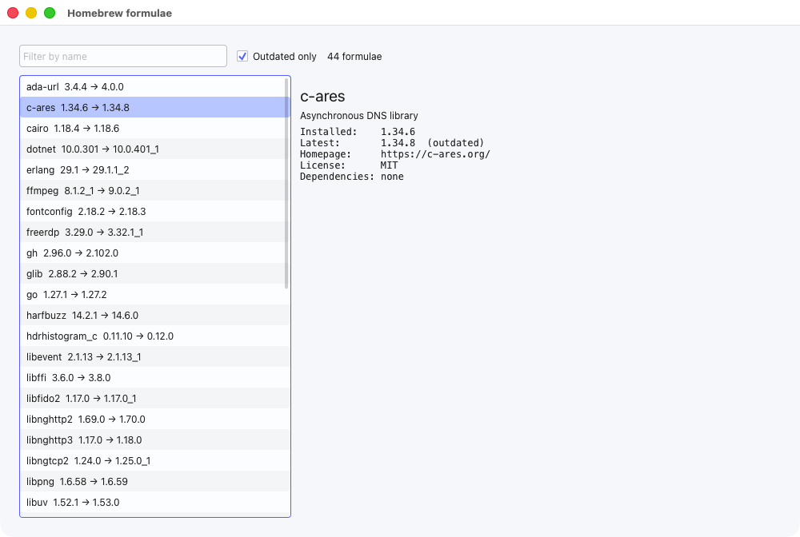

# MewShell

[English](README.md)

[MewUI](https://github.com/aprillz/MewUI) 데스크톱 앱을 위한 명령줄 도구입니다. 명령줄을 보간 문자열로
쓰고, 그 출력을 리스트·드롭다운·그리드에 연결하며, 의존하는 값이 바뀌면 다시 실행합니다.

```razor
var (branch, setBranch) = UseState<string?>("main");
var (commit, setCommit) = UseState<Commit?>(null);

var branches = UseCommand(git, Sh($"git for-each-ref --format=%(refname:short) refs/heads"), r => r.Lines());
var commits  = UseCommand(git, branch is null ? null : Sh($"git log -n 300 --format=... {branch}"), Commit.Parse);
var changes  = UseCommand(git, commit is null ? null : Sh($"git show --numstat --format= {commit.Hash}"), Change.Parse);
```
```razor
<MewDropdown TItem="string" Items="branches.Value" Selected="branch" SelectedChanged="setBranch" />
<MewList TItem="Commit" Items="commits.Value" Selected="commit" SelectedChanged="setCommit" />
<MewTable TItem="Change" Items="changes.Value" Columns="ChangeColumns" />
```

브랜치를 고르면 그 브랜치로 `git log`가 돌고, 커밋을 고르면 그 커밋으로 `git show`가 돕니다. 사용자가
고른 값이 다음 명령줄의 인자로 들어가고, 언제 다시 실행할지는 명령줄이 정합니다.
[`samples/GitView.Razor`](samples/GitView.Razor)가 이 앱 전체이고,
[`samples/GitView.MewUI`](samples/GitView.MewUI)는 같은 앱을 MewUI로만 쓴 것입니다.

## 설치

```bash
dotnet add package Naratteu.MewShell --prerelease         # 명령줄과 세션
dotnet add package Naratteu.MewShell.MewUI --prerelease   # MewUI용 Query, Bind
dotnet add package Naratteu.MewShell.Razor --prerelease   # MewRazor용 UseCommand와 타입 있는 선택 컴포넌트
```

UI 패키지는 코어를 함께 가져오고, `MewShell.Razor`는
[MewRazor](https://www.nuget.org/packages/Naratteu.MewUI.Razor)와 그 MEW001 애널라이저까지 가져옵니다.

에이전트가 GUI 전체를 파일 하나로 작성하고 실행 파일 하나로 배포하게 하려면 [갤러리](#갤러리)와
[에이전트 skill](#에이전트-skill)을 보세요.

## 보간 문자열로 쓰는 명령줄

```csharp
using static MewShell.Shell;

await Sh($"git commit -m {message}");
var head = (await Sh($"git rev-parse HEAD")).Text();
var four = (await (Sh($"seq 1 5") | Sh($"tail -n 2"))).Lines();
```

리터럴 부분은 공백으로 잘려 인자가 됩니다. 보간된 값은 절대 잘리지 않고, 안에 무엇이 들었든 인자
하나입니다. 셸을 거치지 않으니 따옴표 처리할 것도, 주입될 여지도 없습니다:

```csharp
var evil = "a b; rm -rf / $(whoami)";
await Sh($"printf %s {evil}");          // printf는 정확히 인자 두 개를 받습니다
```

리터럴에 붙여 쓴 값은 그 토큰에 합쳐지고(`--author={name}`), 시퀀스는 항목마다 인자 하나가 됩니다
(`git add {files}`). 결과는 `Text()`, `Lines()`, `Fields()`를 제공하고, `StreamAsync()`는 프로세스가
도는 동안 줄을 내보냅니다. 종료 코드가 0이 아니면 예외가 나는데, 세션이 `NoThrow()`면 결과로 돌려줍니다.

## 세션

```csharp
var git = Session.Default.In(repository).Scoped(windowClosed.Token) with { Log = history.Add };
```

세션은 명령이 어디서 돌고 무엇을 물려받는지입니다. 디렉터리, 환경 변수, 실패 시 예외 여부, 취소 토큰,
그리고 각 명령줄을 보는 로그를 가집니다. 불변 값입니다. GUI는 보통 여러 작업이 동시에 도는데, Bun
Shell의 `$.cwd()` 같은 전역 `cd`는 한 창이 다른 창의 디렉터리를 바꿔버릴 수 있습니다. 세션을 파생하는
건 그럴 수 없습니다. 세션 토큰을 취소하면 그 세션에서 시작한 프로세스가 모두 죽으므로, 창을 닫으면
그 창의 명령도 함께 끝납니다.

## UI에 연결하기

### MewUI — `MewShell.MewUI`

```csharp
_commits = _git.Query(_branch, branch => Sh($"git log -n 300 {branch}"), Commit.Parse);
_changes = _git.Query(_commit, commit => Sh($"git show --numstat --format= {commit.Hash}"), Change.Parse);

new ListBox().Bind(_commits, _commit, c => $"{c.Hash}  {c.Subject}")
new GridView().Bind(_changes, _change).Columns(...)
```

`Query`는 항상 최신으로 유지되는 명령 출력입니다. 받은 `ObservableValue`를 따라가다 값이 바뀌면 다시
실행하고, 대체되는 이전 실행은 취소합니다. `Bind`는 그 행들을 `ListBox`, `ComboBox`, `GridView`에 넣고
고른 행을 값으로 돌려줍니다. 그 값이 다음 쿼리의 입력입니다. 고른 행이 새 결과에 없으면 값이 비워지고,
그 아래 단계도 모두 함께 비워집니다.

### MewRazor — `MewShell.Razor`

`ShellComponent`를 상속하면 `UseCommand`를 쓸 수 있고, 타입 있는 선택에는 `MewList`, `MewDropdown`,
`MewTable`을 씁니다. React의 controlled input처럼 `Items`가 들어가고 `Selected`/`SelectedChanged`로
나옵니다. 감싼 MewUI 컨트롤의 파라미터를 모두 유지하므로 `Width`, `Margin`, `Row`, `Column`도 그대로
됩니다.

## 보간된 값이 어떻게 의존성이 되는가

`Sh($"git log {branch}")`는 문자열 포매팅이 아닙니다. C# 컴파일러가 이걸
[보간 문자열 핸들러](src/MewShell/ShHandler.cs)에 조각 단위로 넘겨주기 때문에, 핸들러는 어느 부분이
리터럴이고 어느 부분이 값인지 알고, 각 값을 독립된 인자로 보관합니다. 그 결과가 인자 목록이고,
명령의 `Key`는 그 목록에 디렉터리와 환경 변수를 합친 것입니다.

`UseCommand`는 이 키를 `UseEffect`의 의존성으로 넘깁니다. `branch`가 바뀌면 인자 목록이 바뀌고, 키가
바뀌고, 이펙트가 다시 돕니다. 정리 함수가 이전 실행을 취소해 프로세스를 죽이고, 새 실행이 시작됩니다.
값이 같으면 키도 같아서 아무것도 돌지 않습니다. 명령이 null이면 아무것도 실행하지 않는데, "아직 커밋을
고르지 않음"을 이렇게 씁니다.

추적 장치도 없고, 명령과 맞춰 관리해야 할 의존성 목록도 없습니다. 명령줄이 이미 자기가 무엇에
의존하는지 말하고 있습니다. MewUI에는 람다를 다시 평가할 렌더 루프가 없어서, 그쪽의 `Query`는 입력을
명시적으로 받습니다.

## 갤러리

**[스크린샷 아래에 앱 전체 소스가 있는 갤러리 페이지 →](docs/gallery/README.md)**

앱 하나가 `.cs` 파일 하나입니다. `dotnet run <파일>.cs`로 실행하고, `dotnet publish <파일>.cs`로
NativeAOT 실행 파일 하나를 만듭니다. 실행 파일은 .NET 설치 없이 돌아갑니다. 줄 수에서 주석, 빈 줄,
OS별 플랫폼을 고르는 10줄 블록은 뺐습니다.

| | |
| --- | --- |
|  | **[gitview.cs](docs/gallery/README.md#gitviewcs)**: 47줄, 5.4MB<br>브랜치 → 커밋 → 바뀐 파일 → diff, 그리고 Fetch. 고른 값이 다음 `git` 명령의 인자가 됩니다. |
|  | **[issues.cs](docs/gallery/README.md#issuescs)**: 38줄, 6.0MB<br>`gh --json`으로 저장소 → 이슈 → 본문. 검색창과 고른 저장소가 쿼리 하나에 함께 들어갑니다. |
|  | **[procs.cs](docs/gallery/README.md#procscs)**: 47줄, 5.6MB<br>2초마다 `ps`, 필터 입력창, 선택한 행 Kill. 갱신돼도 선택이 유지됩니다. |
|  | **[pinger.cs](docs/gallery/README.md#pingercs)**: 33줄, 5.3MB<br>오래 도는 명령의 출력을 한 줄씩 스트리밍합니다. Stop을 누르면 프로세스가 종료됩니다. |
|  | **[brewview.cs](docs/gallery/README.md#brewviewcs)**: 67줄, 6.0MB<br>Homebrew 포뮬러, "Outdated only" 체크박스, 상세 패널. 맥락 없는 새 에이전트가 [skill](#에이전트-skill)만 보고 작성한 시험 결과물입니다. |

크기는 macOS arm64 기준이고, Linux arm64 실행 파일은 1MB쯤 더 큽니다. 같은 파일이 Linux에서도
돌아가는 것을 Xvfb에서 확인했습니다. Windows용으로도 컴파일되지만 아직 실행해 보지는 않았습니다.

## 에이전트 skill

[`agent/skills/mewshell`](agent/skills/mewshell)은 코딩 에이전트가 어떤 명령줄 도구에 대해서든 위와 같은
작업을 하도록 가르칩니다.

1. 도구의 도움말을 읽습니다.
2. 기계가 읽기 좋은 출력 형식을 고릅니다.
3. 갤러리를 바탕으로 파일 하나를 씁니다.
4. 실행해서 조작해 봅니다.
5. 실행 파일을 배포합니다.
6. 무엇을 확인했는지 보고합니다.

설치는 다음 중 하나로 합니다.

```text
/plugin marketplace add naratteu/mewshell        # Claude Code. 그다음:
/plugin install mewshell@naratteu

copilot plugin marketplace add naratteu/mewshell # GitHub Copilot. 그다음:
copilot plugin install mewshell@naratteu

gh skill install naratteu/mewshell mewshell --agent claude-code --scope user   # gh가 지원하는 모든 에이전트
```

Codex에서는 `$skill-installer`를 실행하고 `naratteu/mewshell`의 `mewshell` skill을 요청하세요. 폴더를
`.claude/skills/`, `.agents/skills/`, `.github/skills/`에 직접 복사해도 됩니다. 그다음 GUI를 요청하면 됩니다.

> docker GUI 만들어 줘. 실행 중인 컨테이너를 표로 보여 주고, 하나 고르면 아래에 로그가 실시간으로
> 흐르게. Stop, Restart 버튼도 넣고 실행 파일 하나로 배포해 줘.

## 샘플

| | 보여주는 것 | 실행 |
| --- | --- | --- |
| [`GitView.Razor`](samples/GitView.Razor), [`GitView.MewUI`](samples/GitView.MewUI) | 드롭다운 → 리스트 → 그리드 → diff, 고를 때마다 다음 `git` 명령의 인자가 됨, Fetch 버튼 | `dotnet run --project samples/GitView.Razor -- <저장소>` |
| [`Top.Razor`](samples/Top.Razor), [`Top.MewUI`](samples/Top.MewUI) | 1초 폴링과 입력마다 재실행, R3(`Drop`, `Switch`, `Debounce`) 사용 | `dotnet run --project samples/Top.Razor` |

샘플은 macOS 플랫폼을 등록합니다. Windows·Linux에서는
[MewRazor의 표](https://github.com/naratteu/mewrazor/blob/main/README.ko.md)처럼 `Use…` 두 줄을
바꾸세요. Top 샘플은 macOS 명령인 `pgrep`, `sysctl`을 실행합니다.

## NativeAOT

모든 라이브러리가 `IsAotCompatible`로 표시돼 있고, CI는 [`eng/aottest`](eng/aottest)를 NativeAOT로
퍼블리시한 뒤 실행합니다. 실제 프로세스, 파이프, 세션, 취소를 값으로 확인합니다. 그 바이너리는
2.9MB이고, git 탐색기 샘플은 5.3MB(MewUI)와 6.1MB(MewRazor)로 퍼블리시됩니다.

## 아직 안 된 것

- **터미널이 아닙니다.** 프로그램은 터미널이 아니라 파이프를 보므로, 색·프롬프트·페이저는 출력을
  리다이렉트했을 때처럼 동작합니다. 대부분의 도구에 그 경우를 위한 옵션(`--no-pager`, `--porcelain`,
  `NO_COLOR`)이 있습니다. 의사 터미널(PTY)은 별도 작업입니다.
- **내장 명령이 없습니다.** Bun Shell은 `ls`, `cd`, `rm` 등을 내장해서 Windows에서도 스크립트가
  돕니다. 여기서는 명령이 곧 `PATH`에 있는 프로그램입니다.

## 기반

[CliWrap](https://github.com/Tyrrrz/CliWrap)이 프로세스를 돌리고, [MewUI](https://github.com/aprillz/MewUI)가
창을 그리며, [MewRazor](https://github.com/naratteu/mewrazor)가 Razor 컴포넌트를 그 안에 렌더링합니다.

## 라이선스

[VibeCoded AI-Slop License v1.0](LICENSE). 이 코드는 프롬프트로부터 AI가 작성했고, 라이선스는 그게 무슨
뜻인지 솔직하게 적고 있습니다.
